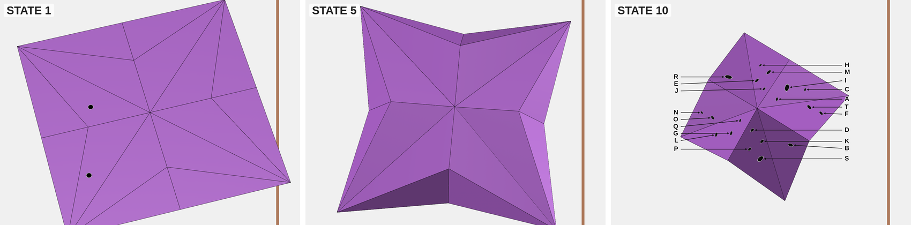

# Origami Point Tracking

A visual reasoning benchmark for vision-language models, generated with a GPU origami simulator. Each item shows a flat sheet of paper with a few unmarked dots, then the sheet folding into an origami base while it turns in front of a fixed camera. In the final image many more dots appear, each with a letter. The model must say which letters are the dots it saw on the flat sheet.



*Images 1, 5 and 10 of a medium item. The answer is `["N", "R"]`.*

The items are built so that the answer cannot be read off the final image. Each tracked dot has a twin decoy at its position under a rotation symmetry of the folded model, so the final image cannot tell the two apart, and the paper spins so that "it turned the short way" is not a safe guess. Only following the paper through the middle frames separates them. [docs/design.md](docs/design.md) explains every construction rule and the shortcut it closes.

This repository contains the generator, the exact presets of the released dataset, and the tools to render, audit and score it.

## The dataset

| | Medium | Expert |
|---|---|---|
| Items | 150 | 150 |
| Images per item | 10 | 14 |
| Dots in the final image | 20 | 16–22 |
| Dots to find | 2–3 | 1–2 |
| Chance (exact match) | 0.4% | 4.0% |
| Claude Opus 5.5, all images | 45.3% | 8.0% |
| Claude Opus 5.5, first and last image only | 18.7% | 8.0% |

**Download:** Hugging Face, `TODO: add the dataset URL`. [docs/dataset.md](docs/dataset.md) describes the files, the row schema, the prompt, scoring and the reference results.

## Quick start

**Evaluate a model.** Answer each row of `dataset.jsonl` (question text plus images in order), write one `{"id": …, "response": …}` line per row, then score:

```bash
python3 tools/score-predictions.py --dataset dataset-300b/dataset.jsonl \
  --predictions predictions.jsonl --out scored.jsonl
```

The scorer reports exact set match with a 95% interval and per-item chance, plus letter-level F1 and format adherence.

**Watch an item in the simulator:**

```bash
bun run dev
```

Then open <http://localhost:3000/?benchmarks=release/dataset-300b/presets.json&benchmark=bird-d3-001&autoRun=true&autoCapture=false>. Without parameters, the page is the interactive simulator.

**Rebuild the dataset** from its presets, or regenerate it from scratch: see [docs/reproduce.md](docs/reproduce.md).

```bash
bun install && bunx puppeteer browsers install chrome
bash release/dataset-300b/render.sh release/dataset-300b/presets.json new_dataset/dataset-300b
```

## Documentation

| Document | Contents |
|---|---|
| [docs/dataset.md](docs/dataset.md) | Composition, file layout, row schema, prompt, scoring, probes, reference results |
| [docs/design.md](docs/design.md) | Tier rules, legibility rules, each shortcut and its countermeasure, audits, limitations, calibration history |
| [docs/reproduce.md](docs/reproduce.md) | Requirements; evaluating, re-rendering and regenerating the dataset; tests |
| [docs/pipeline.md](docs/pipeline.md) | How the generator works: architecture, preset format, generation stages, visibility tests, rendering, server API |
| [tools/README.md](tools/README.md) | Every script in `tools/` with its options |
| [release/dataset-300b/](release/dataset-300b/) | The released presets, their provenance, and the build scripts |
| [docs/uniform-1000.md](docs/uniform-1000.md) | The earlier 1008-item set (tiers 1, 3, 4) |

## Repository layout

| Path | Contents |
|---|---|
| `index.html`, `js/`, `css/`, `dependencies/` | The browser app: the simulator, the benchmark runtime (`js/benchmark.js`), the preset generator (`js/presetGenerator.js`), visibility tests (`js/facePoints.js`) and the label overlay (`js/pointAnnotations.js`). There is no build step; libraries are vendored. |
| `server.js` | Bun dev server: serves the app and accepts images, rows and caches under `DATASET_DIR` |
| `tools/` | Puppeteer drivers (`*.js`), Python orchestrators, audits, scorer and tests |
| `release/dataset-300b/` | Exact presets and build scripts of the released dataset |
| `assets/` | Crease patterns (the bases are in `assets/Bases/` and `assets/SimpleFolds/`) |
| `docs/` | Documentation |
| `CLAUDE.md` | Notes for coding agents working in this repository |
| `test_suite/` | An older evaluation harness for a previous output format (see its README) |
| `CreasePatternScripts/` | Processing scripts from the upstream simulator for drawing some demo patterns |

## Requirements

**Viewing the simulator** needs only a browser and [Bun](https://bun.sh) (≥ 1.3) for the dev server.

**Rendering and generation** also need:

- `bun install`, which installs Puppeteer;
- a headless Chrome (`bunx puppeteer browsers install chrome`);
- Python ≥ 3.10, standard library only.

Each rendering or generation worker uses about one CPU core and 600–800 MB of RAM. Details are in [docs/reproduce.md](docs/reproduce.md#prerequisites).

## Tests

```bash
bun run test:dataset
```

This runs 73 JavaScript and 104 Python tests. They need no server or GPU.

## License and acknowledgements

MIT; see [LICENSE](LICENSE).

The physics simulator at the core of this project is **Origami Simulator** by Amanda Ghassaei, Erik Demaine and Neil Gershenfeld:

- repository: <https://github.com/amandaghassaei/OrigamiSimulator>
- demo: <https://origamisimulator.org>
- paper: [Fast, Interactive Origami Simulation using GPU Computation](http://erikdemaine.org/papers/OrigamiSimulator_Origami7/), 7OSME

It builds on folding mechanics by Mark Schenk and Simon D. Guest ([5OSME](http://www3.eng.cam.ac.uk/~sdg/preprint/5OSME.pdf)) and Tomohiro Tachi ([Freeform Variations of Origami](http://www.tsg.ne.jp/TT/cg/TachiFreeformOrigami2010.pdf)), and uses ruling-aware curved-fold triangulation by [Sasaki and Mitani](http://www.cgg.cs.tsukuba.ac.jp/projects/2020/RulingAwareTriangulation/index.html).

**What comes from upstream.** The simulator code (`js/dynamic/`, `js/model.js` rendering core, `js/pattern.js`, `js/importer.js`, `js/curvedFolding.js` and the other simulator files) and the crease patterns under `assets/` come from, or are adapted from, the upstream project.

**What this project adds.** The benchmark runtime, preset generator, visibility tests, label overlay, `tools/`, `release/` and the benchmark design are contributions of this project.
