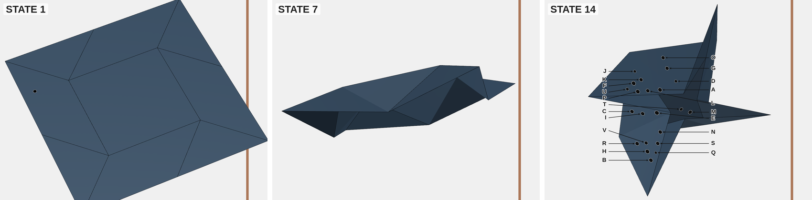

# The point-tracking dataset

This page describes the released dataset: what an item contains, how files are laid out, the row schema, how to score predictions, and the reference results. For why each item is built the way it is, see [design.md](design.md). To regenerate it, see [reproduce.md](reproduce.md).

## At a glance

The release holds **300 items**: 150 at difficulty `medium` (tier 3) and 150 at `expert` (tier 5).

| | Medium (tier 3) | Expert (tier 5) |
|---|---|---|
| Items | 150 | 150 |
| Origami bases (items) | bird 30, boat 29, pinwheel 29, waterbomb 29, open sink 23, square 10 | pinwheel 73, bird 53, waterbomb 23, boat 1 |
| Images per item | 10 | 14 |
| Dots in the final image | 20 | 22 (waterbomb: 16–18) |
| Dots to find (answer size) | 2 (103 items) or 3 (47 items) | 1 (121 items) or 2 (29 items) |
| Dots on the back of the model | none | 2–8 per item (decoys only) |
| Chance (exact match, mean of 1/C(n,k)) | 0.4% | 4.0% |

Open sink and square are under-represented in medium because assembly allows at most three items per set of dotted panels, and these bases offer few distinct panel sets. Expert is mostly bird, pinwheel and waterbomb. Boat, open sink and square carry only a 180° rotation, which puts every twin decoy on the side opposite the back panels, so their expert items cannot show both. One front-only boat item fills the last expert slot (see [design.md § 3](design.md#3-matching-the-flat-and-final-images--twin-decoys)).

## What an item looks like


*Medium item `origami_point_tracking_difficulty_3_birdbase_01`, images 1, 5 and 10 of 10. The answer is `["N", "R"]`.*



*Expert item `origami_point_tracking_difficulty_5_pinwheelbase_01`, images 1, 7 and 14 of 14. The answer is `["F"]`.*

- **First image.** The flat sheet with the dots to be tracked, drawn as unmarked black dots.
- **Middle images.** The sheet folding while the model rotates in front of a fixed camera. No dots are drawn.
- **Last image.** The folded model with every visible dot labelled by a letter on a leader line. Besides the tracked dots, it shows decoys that were never drawn earlier. Each dot is drawn at its own random size in this image only (0.6–1.4× for medium, 0.75–1.25× for expert), so size cannot match a dot to the first image.

Both sides of the paper have the same color. Each image is a 1280×960 PNG with a `STATE n` caption in the top-left corner.

## Files

```
dataset-300b/
├── dataset.jsonl                          one row per item (300 rows)
├── <id>/step_0000_current.png … step_NNNN_current.png
│                                          images, 4-digit and 0-based (medium 0000–0009, expert 0000–0013)
├── metadata/<Object>_metadata.json        per-base metadata, keyed by preset name, including the exact preset (presetConfig)
├── metadata/<Object>_summary.json         per-base visibility summaries (visible points at each step)
├── probe_first_last.jsonl                 same rows, only the first and last images
├── probe_first_last_reworded.jsonl        same, with the task text rewritten for two images
├── probe_final_only.jsonl                 same rows, only the last image
└── probe_final_only_reworded.jsonl        same, with the task text rewritten for one image
```

Image paths in `dataset.jsonl` are relative to the dataset directory.

## Row schema

```json
{
  "id": "origami_point_tracking_difficulty_3_birdbase_09",
  "category": ["Order", "origami_static", "point_tracking"],
  "type": "perception",
  "question": "[Task] … {images} … [Answer Format] …",
  "images": ["origami_point_tracking_difficulty_3_birdbase_09/step_0000_current.png", "…"],
  "gt_answer": "[\"F\", \"L\"]",
  "meta_info": { "…": "see below" }
}
```

`gt_answer` is a **JSON-encoded string** holding a list of letters, not a list. Decode it with `json.loads`. `meta_info.initial_points` holds the same letters as a real list.

| `meta_info` field | Meaning |
|---|---|
| `difficulty` | `medium` or `expert` |
| `object` | Origami base, e.g. `birdBase` |
| `level` | `<base>_difficulty_<tier>`, e.g. `birdbase_difficulty_3` |
| `benchmark` | Name of the preset that produced the item, e.g. `bird-d3-009` (key into `metadata/<Object>_metadata.json`) |
| `seed` | Numeric suffix of the preset name |
| `config` | Path of the metadata file for this base |
| `total_steps` | Number of images |
| `all_labels` | Every letter in the final image |
| `initial_points` | Letters of the tracked dots (the answer) |
| `hidden_point_labels` | Letters of the decoys, which are drawn only in the last image |
| `front_points`, `back_points` | Letters of dots on the front and back faces of the sheet |
| `color_mode` | Renderer color mode (`labelOnly`: one color on both sides) |
| `placement` | How the dots were laid out: Dirichlet `alpha`, the rotation `symmetry` used for twin decoys, and the drawn `trackedGroups`, `decoyGroups`, `backGroups`, `scatter` and `trackedScatter` sizes. See [design.md](design.md). |
| `task_name`, `repeat_index` | Constant (`origami_static`, `0`) |

## The question

Every row's `question` uses the same template (`JSONL_QUESTION_TEMPLATE` in [`js/benchmark.js`](../js/benchmark.js)). Only the dot count and the letter list change. A medium example:

```
[Task]
You are solving origami point tracking.
In this task, you must identify which labeled points on a folded piece of paper correspond to the unmarked dots placed on the original flat (unfolded) paper. The first image shows the flat paper with 2 unmarked dot(s) printed on it. The following images show the same paper being folded step by step, ending with the fully folded result where every visible point is labeled using the letters A, B, C, …, T. Paper is opaque: points on the back side may be hidden by overlying layers, and the same physical dot may appear in different positions across steps as the paper folds. The camera stays fixed, but the paper may rotate between images, sometimes by a large angle. Points are drawn only in the first and last images; the images in between show the paper without points. In the last image the dots are drawn at different sizes than before; a dot's size does not show which dot it is. You must track each unmarked dot through the fold sequence and report the letter(s) in the final image that correspond to the original unmarked dot(s).
If this task depends on a specific visual definition, use this definition exactly: not applicable
The visual evidence for this question is provided below.
{images}

[Rules]
1. Use only the images and text provided in this prompt.
2. If answer options are provided, choose only from the provided options.
3. Do not output explanation beyond the required final answer.

[Question]
Which lettered point(s) in the final folded image correspond to the unmarked dot(s) shown on the flat paper in the first image? List the matching letter(s).

[Answer Format]
Output exactly one JSON object: {"answer": {json_answer_value}} and nothing else.
Replace {json_answer_value} with the single answer for this task, formatted according to a JSON array of uppercase letters chosen from [A, B, C, …, T], with no duplicates, e.g. ["A", "C"].
```

Two placeholders stay in the text on purpose:

- `{images}` marks where an evaluation harness inserts the images, in `images` order.
- `{json_answer_value}` is literal text that the model is asked to replace with its answer.

The question tells the model the number of dots to find. It does not say which base is shown.

## Scoring

[`tools/score-predictions.py`](../tools/score-predictions.py) is the reference scorer. Predictions are JSONL lines of `{"id": …, "response": "<raw model text>"}` or `{"id": …, "answer": [...]}`.

```bash
python3 tools/score-predictions.py --dataset dataset-300b/dataset.jsonl \
  --predictions predictions.jsonl --out scored.jsonl
```

- **Headline metric:** exact set match against `gt_answer`, ignoring order. The scorer reports it with a 95% Wilson interval and the per-item chance level.
- **Partial credit:** letter-level F1.
- **Format adherence** is reported separately as `format_ok`. A correct answer wrapped in prose or a code fence still scores.
- **Failures:** unparsed, invalid and missing predictions score zero and are counted by status.

With exact match over 150 items, the 95% interval on one model's score is about ±5 points at a 10% score and ±8 points at 50%. A difference between two models on the same items is noisier, up to about ±11 points, so treat smaller gaps as unresolved.

## Probes

The four `probe_*.jsonl` files keep every row's `id` and `gt_answer` but send fewer images. Score them with `score-predictions.py` against `dataset.jsonl`.

- **`probe_final_only`** (last image only): a score well above chance would mean the answer can be read from the final layout alone.
- **`probe_first_last`** (first and last images): a score close to the full-sequence score would mean the middle images are not needed.
- **`_reworded` variants** rewrite the task paragraph to describe the images actually sent. The plain variants keep the full-sequence wording.

[`tools/build-probes.py`](../tools/build-probes.py) writes the probe files next to any `dataset.jsonl`.

## Reference results

One run of Claude Opus 5.5 (`claude-opus-5-5`) through [`tools/eval-claude.py`](../tools/eval-claude.py) answered all 300 rows. It used the system prompt "You are a helpful assistant.", sent the images before the question text, and had tools disabled.

| | Medium | Expert | All |
|---|---|---|---|
| Full sequence | 45.3% (68/150) | 8.0% (12/150) | 26.7% |
| First and last images (reworded) | 18.7% (28/150) | 8.0% (12/150) | 13.3% |
| Chance | 0.4% | 4.0% | 2.2% |

How to read these numbers:

- **Medium:** the score drops by more than half without the middle images, so the fold sequence carries most of the signal.
- **Expert:** this model scores near chance with or without the middle images.

By base, full sequence:

| Base | Medium | Expert |
|---|---|---|
| bird | 47% | 4% |
| boat | 34% | — (1 item) |
| open sink | 48% | — |
| pinwheel | 41% | 11% |
| square | 70% | — |
| waterbomb | 48% | 4% |

Scores are from a single sampled run. Re-asking the same 150 medium items in an earlier render gave 46%.

## Provenance and reproduction

Every item names its preset in `meta_info.benchmark`. The exact preset, including camera, per-step rotations, fold amounts and barycentric dot positions, is stored under that name in `metadata/<Object>_metadata.json` (`presetConfig`) and in the release's preset bank. Rendering the bank again reproduces the images. [reproduce.md](reproduce.md) covers both re-rendering and regenerating from scratch.

## Earlier datasets

The same code built two earlier sets. Neither is part of the release.

- **`eval/`** (built 2026-10-01 by [`tools/build-eval.py`](../tools/build-eval.py)). It has 150 medium and 150 expert items over seven bases including mapfold, with 8 (medium) or 10 (expert) dots and two answers per item. It predates twin decoys, the spin, scatter dots and end sizes, and served as the starting point for the difficulty calibration described in [design.md](design.md#calibration-history).
- **uniform-1000** (tiers 1, 3 and 4, 1008 items). It used the original per-tier rules: different colors on each side of the paper and larger dots. See [uniform-1000.md](uniform-1000.md).
