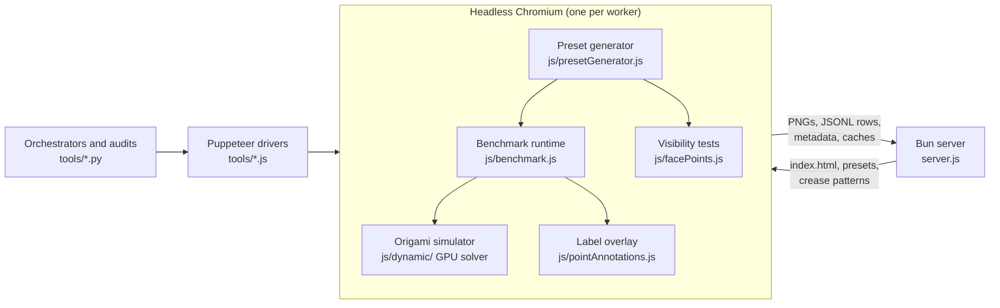

# How the generator works

This page explains the code: how a browser-based origami simulator becomes a dataset generator, what each stage of generation does, and what the renderer writes. [design.md](design.md) explains *why* the tiers are built the way they are. [tools/README.md](../tools/README.md) lists every script and its options.

## Architecture



- **The simulator** is Origami Simulator by Ghassaei, Demaine and Gershenfeld. It loads a crease pattern (SVG or FOLD) and solves for the folded shape on the GPU. Physics runs in WebGL fragment shaders, whose source is embedded in [`index.html`](../index.html); the compute layer is [`js/dynamic/`](../js/dynamic/). A fold amount from 0 to 100% sets every crease's target angle, and the solver relaxes the sheet toward it.
- **The benchmark runtime** ([`js/benchmark.js`](../js/benchmark.js)) does four jobs. It loads presets, applies a camera view and a per-step model rotation, steps through fold amounts, and captures images. It also builds each dataset row, and it holds the trajectory-search machinery that the generator calls.
- **The preset generator** ([`js/presetGenerator.js`](../js/presetGenerator.js)) runs inside the page. Given a base and a tier, it searches trajectories, lays out dots, refines their positions and validates the result.
- **The drivers** ([`tools/generate-presets.js`](../tools/generate-presets.js), [`validate-presets.js`](../tools/validate-presets.js), [`render-dataset.js`](../tools/render-dataset.js)) launch headless Chromium with Puppeteer, open the page, and call into it.
- **The orchestrators** (Python, standard library only) run many driver processes in parallel. They assemble and select banks, render datasets, and audit and score them.
- **The server** ([`server.js`](../server.js), `bun run dev`) serves the page and accepts writes under its `DATASET_DIR`.

The browser code has no build step and no module system. Each file defines `initX(globals)` and returns a module object; [`js/main.js`](../js/main.js) wires them into one shared `globals` object. Third-party libraries (Three.js, jQuery, numeric.js) are vendored in `dependencies/`.

## Presets

A **preset** fully determines one item. Banks are JSON objects keyed by preset name ([`release/dataset-300b/presets.json`](../release/dataset-300b/presets.json) is one). The main fields:

| Field | Meaning |
|---|---|
| `model` | Crease pattern under `assets/`, e.g. `/Bases/birdBase.svg` |
| `difficulty` | Tier, 1–5 |
| `steps` | One entry per image: `fold` (0–100), `pov` (a camera direction: `iso`, `x`, `-x`, `y`, `-y`, `z`, `-z`, or a vector `[x,y,z]`), and `rotation` (Euler XYZ radians on the model, applied after the camera) |
| `facePoints` | The dots: `[{faceId, u, v, w, …}, …]`, each a barycentric point on a mesh triangle. `faceId`s from 0 to N−1 are front faces and N to 2N−1 back faces. Optional flags: `hidden: true` marks a decoy drawn only in the last image; `twin: true` marks a twin decoy and `pair` links it to its seed dot; `scatter: true` marks a scatter dot (`near`: the group it started beside); `endScale` is the dot's size in the last image. |
| `colorMode`, `color1`, `color2` | Paper rendering (`labelOnly` with one color for both sides in the clustered tiers) |
| `pointRadius`, `endDotSizes` | Dot radius, and the range of last-image size multiples |
| `labelStyle` | `arrow`: letters on leader lines in two side lanes |
| `hidePointsDuringAnimation` | Hide dots in the middle images |
| `trackingEvalMode` | `finalStepOnly`: decoys must be visible in the last image only. Non-hidden dots must always be visible at every step, whatever the mode. |
| `clusterPlacement` | The drawn layout, Dirichlet α and twin symmetry ([design.md](design.md)) |
| `minPointViewQuality`, `minPointSeparationPx`, `requirePointClearance`, `enforceSeparationAllSteps` | The legibility rules the preset was generated under; validation re-applies them |

The letter of each dot is its index in `facePoints` (A, B, C, …). `facePoints` can also be given as `{faceId: count}` or `{faceId: [[u,v,w], …]}` for hand-written presets. Any field can be overridden with a URL parameter of the same name.

### Viewing an item in the browser

```bash
bun run dev
```

Then open:

```
http://localhost:3000/?benchmarks=release/dataset-300b/presets.json&benchmark=bird-d3-001&model=Bases/birdBase.svg&autoRun=true&autoCapture=false
```

This plays the preset in the interactive simulator: the flat sheet with its dots, the folding sequence, and the lettered final pose.

- **`model`.** Set it to the preset's `model` without its leading slash, for example `Bases/pinwheelBase.svg` for a `pinwheel-d5-…` preset. The page loads a base by clicking its entry in the Examples menu, whose paths have no leading slash. Without the parameter, a preset whose path starts with `/` never loads, and `autoRun` fails. The headless tools load bases directly and are not affected.
- **`autoCapture=false`.** Keep it; otherwise the page writes PNGs into the server's `DATASET_DIR`.

Without `?benchmarks=`, the page is the plain interactive simulator.

## Generating presets

One **job** is one call to `tools/generate-presets.js` for a base, a tier and a seed. It loads the page, runs the in-page generator, and writes a bank. A job has five stages.

### 1. Face pools

For each base, the generator scans the folded model from many camera directions and records which faces are visible and how squarely. The result is cached per base in `assets/facepools/<Folder>_<name>_svg.json` (written through the server's `/api/face-pools`).

### 2. Trajectory search

A **trajectory** pairs a fixed camera direction with a rotation profile: one model rotation per step. For the clustered tiers:

- the medium profile is a ramp plus a spin;
- the expert profile is a motion-style path plus a spin about the normal.

Candidates cover many camera directions. Each candidate is replayed in the live simulator (300 ms settle per step) and gets a **visibility timeline**: which faces are readable at each step. A trajectory is accepted when its timeline supports the tier's needs:

- enough panels that stay readable at every step to hold tracked dots;
- readable pairs of front panel and twin panel in the final frame;
- for expert, readable back panels.

Clustered tiers re-check the final pose at 800 ms, because the folded shape can settle differently after a longer wait. Results are cached by content in `<DATASET_DIR>/.scan-cache/`, so larger searches reuse earlier evaluations.

### 3. Dot layout

For each accepted trajectory, the generator draws a layout: group sizes, which groups are tracked, decoy-only and back groups, and scatter dots. It then assigns groups to panels the trajectory keeps readable. For clustered tiers, each seed dot gets a twin on the panel that the chosen rotation symmetry maps it to, linked with `pair`. The point array is shuffled with the job seed, so answer letters carry no information.

### 4. Refinement

Each dot's barycentric position is chosen by replaying the preset through every step and testing candidate positions:

| Gate | Requirement |
|---|---|
| Visibility | `isPointVisible` passes |
| Frame margin | ≥ 30 px |
| Spacing | ≥ the tier's floor |
| Viewing ratio | ≥ 0.30 |
| Surface clearance | Clear |
| Twin | The dot's twin passes the same gates |

Candidates that pass every gate are ranked in two tiers:

- **Tier 1:** the dot also has forward clearance (below).
- **Tier 2:** the dot does not, and takes a 10⁶ penalty, so any tier-1 spot wins.

How the winning spot is picked depends on the tier:

- **Unclustered tiers** score margin, spacing and distance from the triangle's edges, and take the best.
- **Clustered tiers** sample instead ([design.md § 2](design.md#2-position-within-a-group--sampled-placement-and-balancing)): a panel's first dot goes to the legible spot nearest a Dirichlet sample, and later dots to random legible spots around a group center.

### 5. Validation

The generator validates refined presets in the page. It tries spare candidates until the requested count passes or the pool runs out, and it never falls back to an easier tier.

`tools/generate-expert-dataset.py` then replays every job's bank with `tools/validate-presets.js` at 800 ms per step and keeps only presets that pass. The replay records every dot's final screen position and viewing ratio (`quality.finalScreens`, `quality.finalViewQuality`), which the audits and selection use. With `--trace`, it records them for every step.

## Point visibility

[`js/facePoints.js`](../js/facePoints.js) has two tests. Both use raw ray–triangle intersection without back-face culling, so folded layers block the view from either side.

- **`isPointVisible(i)`** is the visibility contract used by rendering and validation. It checks three things in order:
  1. Face normal: the dot's side of the sheet faces the camera.
  2. Frustum: the projected point lies inside the image.
  3. Occlusion: a ray from the dot to the camera hits no other triangle. The ray starts 0.002 units off the surface.
- **`hasForwardClearance(i, dist)`** is a stricter ranking signal used in refinement. It imagines a short arrow along the face normal and checks that both the arrow's path and its tip are clear. This catches flaps hovering just above a dot, which pass a plain ray test but crowd the dot in the image.

## Rendering

[`tools/render_dataset_parallel.py`](../tools/render_dataset_parallel.py) splits a bank into shards. Each shard goes to one `tools/render-dataset.js` process, which drives one headless page. For each preset, the page does four things:

1. Loads the base and resets the solver to the flat sheet.
2. Applies the preset.
3. Steps through `steps`, waiting `pauseDuration` per step and capturing an image. Dots are hidden in the middle images.
4. Captures the last image with the lettered overlay ([`js/pointAnnotations.js`](../js/pointAnnotations.js)).

**The overlay** projects each dot to the screen and splits labels into left and right lanes. It then moves labels so that leader lines cross as few dots and other lines as possible, and each arrowhead stops 3 px outside its dot's rim. Left-lane labels start below the `STATE n` caption (`captionBottom`), which is drawn over the top-left corner afterwards.

**What the page posts.** The page sends images, the JSONL row and the metadata to the server. `<DATASET_DIR>` then holds:

```
<DATASET_DIR>/
├── dataset.jsonl                     one row per preset (rows are replaced by id on re-render)
├── <id>/step_NNNN_current.png        one image per step
├── metadata/<Object>_metadata.json   per base, keyed by preset name (includes presetConfig)
├── metadata/<Object>_summary.json    per base: visible points at each step
└── .scan-cache/                      trajectory-search cache (generation only)
```

The renderer skips a preset only when its configuration, metadata, JSONL row and every image already match. [dataset.md](dataset.md#row-schema) documents the row schema.

### Server endpoints

| Endpoint | Purpose |
|---|---|
| `POST /api/screenshot?folder=…` | Save a captured PNG under `DATASET_DIR` |
| `POST /api/jsonl-append` | Add a row to `dataset.jsonl`, replacing any row with the same `id` (`fresh: true` truncates first) |
| `POST /api/metadata-merge` | Set one key in a JSON object file under `DATASET_DIR` (used for per-base metadata) |
| `GET`/`POST /api/scan-cache?key=…` | Read or write a trajectory-search cache entry |
| `GET`/`POST /api/face-pools` | Read or write a face-pool cache file in `assets/facepools/` |

`DATASET_DIR` (default `dataset`) and `PORT` (default 3000) are environment variables of `server.js`. The orchestrators check that the server writes where they expect before they start.

## Runners

| Runner | Tiers | What it adds |
|---|---|---|
| [`tools/generate-expert-dataset.py`](../tools/generate-expert-dataset.py) | 3, 5 | Model-balanced job scheduling (seed per job = `base_seed + 7919·job`), the 800 ms validation replay, assembly with contract checks, dedup by preset content, spread over camera views, at most three presets per panel set, and balancing of the middle-dot, least-turn and twin-facing rates. Used for the release. |
| [`tools/generate-matrix.js`](../tools/generate-matrix.js) | 1, 3, 4, 5 | Parallel (base, tier) slots with optional sharding. |
| [`tools/generate-uniform-1000.py`](../tools/generate-uniform-1000.py) | 1, 3, 4 | The uniform-1000 orchestrator: generation passes, assembly and rendering ([uniform-1000.md](uniform-1000.md)). |

**Bases** are crease patterns under `assets/`:

| Key | Pattern |
|---|---|
| `bird` | `/Bases/birdBase.svg` |
| `waterbomb` | `/Bases/waterbombBase.svg` |
| `pinwheel` | `/Bases/pinwheelBase.svg` |
| `boat` | `/Bases/boatBase.svg` |
| `opensink` | `/Bases/openSinkBase.svg` |
| `square` | `/Bases/squareBase.svg` |
| `mapfold` | `/SimpleFolds/mapfold.svg` |
| `simplevertex` | `/SimpleFolds/simpleVertex.svg` |

The release uses the first six. Mapfold carries no rotation symmetry, so the clustered tiers cannot use it. Simplevertex rarely passes their final-frame checks. The frog base (`assets/Bases/frogBase.svg`) is excluded from every tier: its folded layers are too dense for readable dots.
